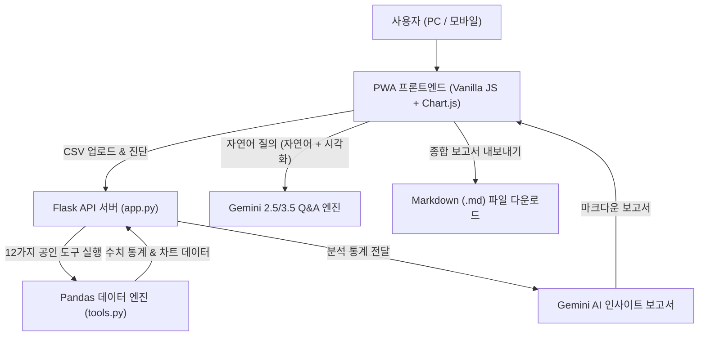

# ⚜️ The Throne of Nazarick - AI Data Insight Builder

> **지고의 41인에 필적하는 Python Pandas의 절대적 연산력과 마도왕 Gemini AI의 혜안**  
> 애니메이션 **오버로드(OVERLORD)** 나자릭 지하대분묘 테마의 고성능 데이터 분석 & PWA 웹 애플리케이션

<p align="center">
  
</p>

<p align="center">
  
  
  
  
  
  
</p>

---

## 📖 프로젝트 개요

**The Throne of Nazarick - AI Data Insight Builder**는 복잡한 통계 및 원천 CSV 데이터를 단 한 번의 업로드로 정밀 진단하고, 12가지 공인 데이터 연산 도구와 최신 Google Gemini AI 모델을 통해 지능형 시각화 차트와 종합 보고서를 도출하는 풀스택 웹 애플리케이션입니다.

애니메이션 **오버로드(OVERLORD)**의 흑요석(Obsidian), 로열 골드(Royal Gold), 크림슨(Crimson) 디자인 시스템을 기반으로 구축되었으며, **PWA(Progressive Web App)** 지원으로 PC 및 모바일 어디서나 독립 네이티브 앱처럼 설치하여 이용할 수 있습니다.

---

## ✨ 핵심 기능 (Key Features)

### 1. 📁 스마트 CSV 자동 진단
- **다중 인코딩 자동 감지:** UTF-8, UTF-8-BOM, CP949, EUC-KR을 순차적으로 자동 테스트하여 한글 깨짐 현상 원천 차단
- **메타데이터 스킵:** 상단 행에 출처나 주석이 포함된 복합 CSV 파일(예: World Bank 데이터)의 실제 헤더 시작 위치 자동 판별
- **데이터 구조 파악:** 세로형(Long) vs 가로형(Wide) 연도 열 여부, 결측률, 중복 행, 이상 컬럼명 자동 진단

### 2. 💬 자연어 질문 & 동적 차트 답변 (Natural Language Q&A)
- 추천 분석 이전에 데이터셋에 대해 일상 언어로 자유롭게 질문 가능
  - *예: "한국의 연도별 추이는 어때?", "최근 연도 기준 상위 5개국과 한국을 비교해줘"*
- **지능형 시각화:** 답변 본문 아래 `📊 시각화 자료 보기` 토글 버튼 제공
- **세로 막대 그래프 & 한국 자동 비교:** 막대형 시각화 시 항상 직관적인 세로 막대로 렌더링되며, 비교 대상 우측에 대한민국(한국) 데이터를 황금빛으로 강조 포함
- **가독성 최적화 스케일링:** 미세한 차이를 한눈에 식별할 수 있도록 세로축 자동 스케일링 및 막대 상단 수치 라벨 표기

### 3. ⚙️ 12가지 공인 데이터 가공 & 통계 도구 (Official Tools)
1. **가로형 연도 열들을 세로형(Long) 행으로 접기 (`reshape_wide_to_long`)**
2. **결측치·중복·이상한 열 이름 품질 진단 보고서 (`quality_report`)**
3. **연도별 값 개수와 권장 기준연도 계산 (`year_coverage`)**
4. **World, 소득 그룹 등 집계 행 후보 탐지 (`detect_aggregates`)**
5. **개수·평균·중앙값·최소·최대·표준편차 기술통계 (`describe_numeric`)**
6. **선택 항목들의 연도별 시계열 추이 선 차트 (`trend_line`)**
7. **기준연도 기준 상위·하위 N개 순위 막대 (`top_bottom_n`)**
8. **대륙/소득 등 그룹별 평균·합계·개수 막대 (`group_summary`)**
9. **두 시점 사이 변화량(%p)과 변화율(%) 막대 (`change_rate`)**
10. **수치 구간별 빈도 분포 히스토그램 (`distribution`)**
11. **두 시점/변수 간 피어슨 상관계수 산점도 (`correlation_scatter`)**
12. **특정 항목(한국 등) vs 전체 평균·중앙값 강조 막대 (`compare_one_vs_all`)**

### 4. 🧠 Gemini AI 심층 보고서 & 대화형 멀티턴 질의 (Chat)
- 연산된 수치 결과를 바탕으로 Gemini 모델이 핵심 사실, 통계적 의미, 의사결정 시사점을 체계적인 마크다운 보고서로 작성
- 생성된 분석 보고서에 대해 실시간 후속 질의응답 및 심층 대화 기능 제공

### 5. 📥 종합 보고서 Markdown (.md) 원클릭 내보내기
- 데이터 진단 요약, Pandas 연산 결과, Gemini AI 보고서 및 질문/답변 내역을 통합 정리한 마크다운 리포트 파일 다운로드

### 6. 📱 PWA (Progressive Web App) 완벽 지원
- **오버로드 마도왕 아인즈 울 고운 전용 아이콘 세트** 탑재 (512px, 192px, 144px, 96px, Favicon)
- **접속 시 설치 모달:** 페이지 진입 시 `지금 당장 앱 설치` 안내 팝업과 `설치하기`, `나중에 설치하기` 원클릭 제어
- **서비스 워커(`sw.js`):** 정적 자산 사전 캐싱, 루트 스코프(`/`) 제어, 오프라인 결계 상태 배너 표시
- PC Chrome/Edge 주소창 및 모바일 브라우저 홈 화면 바로가기 완벽 호환

### 7. 🛡️ 나자릭 성물고 보안 규약 (메모리 전용 보안)
- 업로드된 CSV 파일은 서버 디스크에 저장되지 않고 휘발성 메모리(RAM)에서만 처리되며, 서버 재기동 시 자동 소멸

---

## 🏗️ 시스템 아키텍처



---

## 📂 디렉토리 구조

```plaintext
data-insight-builder/
├── app.py                  # Flask 백엔드 API & 라우팅 & 서비스 워커 엔드포인트
├── tools.py                # 12가지 공인 Pandas 연산 및 통계 처리 도구 모듈
├── requirements.txt        # 파이썬 의존성 패키지 목록
├── .env.example            # 환경 변수 템플릿 파일
├── .gitignore              # Git 추적 제외 규칙 (.env 등)
├── README.md               # 프로젝트 안내 문서
├── templates/
│   └── index.html          # 오버로드 나자릭 테마 메인 웹 인터페이스 & PWA 모달
└── static/
    ├── style.css           # 나자릭 다크 판타지 골드/크림슨 전용 스타일시트
    ├── app.js              # 프론트엔드 상태 머신, Chart.js 연동 & PWA 제어 로직
    ├── manifest.json       # PWA 웹 앱 매니페스트 설정
    ├── sw.js               # PWA 서비스 워커 (캐싱 및 오프라인 제어)
    └── icons/              # 아인즈 울 고운 고화질 앱 아이콘 세트
        ├── icon-512x512.png
        ├── icon-192x192.png
        ├── icon-144x144.png
        ├── icon-96x96.png
        ├── favicon.png
        └── overlord-master.png
```

---

## 🚀 빠른 시작 가이드 (Getting Started)

### 1. 요구사항
- **Python:** 3.10 이상 권장
- **Google Gemini API Key:** [Google AI Studio](https://aistudio.google.com/app/apikey)에서 발급

### 2. 프로젝트 복제 및 가상환경 설정
```bash
# 1. 저장소 복제
git clone https://github.com/ghdnjsch123-cyber/data-insight-builder.git
cd data-insight-builder

# 2. 파이썬 가상환경 생성 및 활성화
python -m venv .venv

# Windows (PowerShell)
.\.venv\Scripts\Activate.ps1

# macOS / Linux
source .venv/bin/activate

# 3. 필수 라이브러리 설치
pip install -r requirements.txt
pip install Pillow
```

### 3. 환경 변수 설정
`.env.example`을 복사하여 `.env` 파일을 생성하고 발급받은 Gemini API 키를 입력합니다:
```bash
cp .env.example .env
```

`.env` 파일 편집:
```env
# Google Gemini API Key
GEMINI_API_KEY=AIzaSy...당신의_API_키...

# 사용할 Gemini 모델명
GEMINI_MODEL=gemini-2.5-flash

# Flask 디버그 모드
FLASK_DEBUG=true

# 최대 업로드 허용 크기 (MB)
MAX_UPLOAD_MB=10
```

### 4. 서버 실행
```bash
python app.py
```
브라우저에서 **`http://127.0.0.1:5000`** 으로 접속합니다.

---

## 📱 PWA 앱 설치 방법

1. 브라우저로 접속하면 화면 중앙에 **"지금 당장 앱 설치"** 팝업 모달이 나타납니다.
2. **`📱 설치하기`** 버튼을 누르면 브라우저의 네이티브 설치 확인창이 열립니다.
3. 설치 완료 시 바탕화면 및 앱 목록에 **아인즈 울 고운 아이콘**을 가진 독립 앱으로 등록되며, 주소창 없는 전체 화면 모드로 빠르게 실행할 수 있습니다.

---

## 🌐 Vercel 배포 안내

Vercel에 배포할 때는 다음 사항을 권장합니다:
1. **환경 변수 등록:** Vercel 프로젝트 대시보드 ➔ `Settings` ➔ `Environment Variables`에 `GEMINI_API_KEY`를 추가합니다.
2. **배포 보호 해제:** 외부 방문자 및 PWA 서비스 워커가 정상 접근할 수 있도록 `Settings` ➔ `Deployment Protection`에서 `Vercel Authentication`을 `Disabled`로 설정합니다.

---

## 📜 라이선스

본 프로젝트는 개인 학습 및 포트폴리오 목적으로 제작되었습니다.  
오버로드(OVERLORD)의 세계관 및 모티브는 원작자(쿠가네 마루야마)와 공식 제작위원회의 저작권을 존중합니다.
